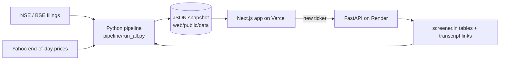

# FINN

A phone-first investing assistant that only interrupts you when something should change what you believe about a stock you own.

**Live app:** `<add your Vercel link>` · open it on your phone, then *Add to Home Screen*.

---

## Try it in 60 seconds

1. **Today**: the top cards are the only things that touch *why you own a stock* or *what management promised*. Everything else is one line or folded away.
2. Tap a company name to open its **Promise Scoreboard**: every target management gave in the last four earnings calls, marked kept, missed, revised, quietly dropped or pending.
3. Tap any quote chip (`❞ p.4`). You get the exact sentence and a link to that page of the transcript.
4. Go to **Settings**, change *Volume spike* to 1.5×, and go back to Today. The alerts change on the spot.
5. Go to **Research**, type any NSE symbol, and watch it read the company live.

---

## The idea

Most of what an investor reads in a day changes nothing. Ranking filings by a fixed list (results > dividend > AGM notice) doesn't fix that, because importance isn't a property of the filing. A capex plan is big news if you own the stock for capital efficiency, and noise if you own it for volume growth.

So FINN keeps two ledgers and checks every filing and every price move against them:

- **My pillars**: the 2–3 reasons I own each stock, written so code can check them. For example "revenue grows 15%+ a year", "EBITDA margin stays above 12%", "promoter doesn't pledge shares".
- **Management's promises**: every dated target from the last four earnings calls, with the exact quote and page.

Anything that touches either ledger goes to the top. Material filings that touch neither get one line. Routine paperwork is folded into a single row. The app tells you how much it folded away, so you can trust the filter.

Four signals fall out of this that a plain feed can't give:

| Signal | What it means |
| --- | --- |
| **Results day settles promises** | The results card shows Revenue, EBITDA, PBT and PAT vs last quarter and last year, then marks which promises fell due and whether they were kept. |
| **Orphaned promises** | When a CFO resigns, FINN lists the open targets *that person* gave on calls. Their promise has lost its owner. |
| **Unexplained moves** | A volume spike the day after results is explained. The same spike with no filing behind it is a question, so it ranks higher. |
| **Quietly dropped guidance** | A target mentioned in earlier calls that management stopped talking about. Summarising the latest call can't catch this; you have to compare calls. |

---

## How it's built



**Static first.** The pipeline does the heavy work once and writes a JSON snapshot that ships with the web app. The app never waits on NSE or a model, so the demo can't break because a source is slow. The API is used only to research a ticker that wasn't precomputed.

**Facts on the server, preferences on the device.** The pipeline decides facts (category, numbers, promise status). Your thresholds, watched categories and pillars are applied in the browser, so you can change them in Settings and see the result instantly, with no database.

---

## Which model does what (and why it's cheap)

| Step | How | Why |
| --- | --- | --- |
| Sort filings into categories | Regex rules in `config/rules.yaml`. Leftovers go to the cheap model in one batched call | Filing subjects are formulaic, so rules are free, instant and explainable |
| One-line summaries | Cheap model, 8 filings per call, material filings only | Routine filings never reach a model |
| Find promises in transcripts | Cheap model, one call per transcript | Only management's forward-looking sentences are sent; analyst questions are dropped first |
| Check each quote | Code | Every quote must actually be on its page, or it's thrown away |
| Link promises across calls, settle them | Code | Reaffirmed / revised / dropped and kept / missed are arithmetic, not judgment |
| Promises code can't settle + "narrative vs numbers" | Strong model | Sees only a small table, about one call per company |
| Results card numbers | screener.in table. The cheap model reads the filing PDF only when screener hasn't updated yet, and cross-checks PAT | Structured data beats parsing PDFs when it's available |
| Business snapshot | Cheap model on management's opening remarks, page-cited | |
| Bull vs bear, red-team of my pillars | Strong model on numbers + ledger + 20 most relevant passages | Judgment, on a small input |

Every model answer is cached by *model + prompt version + input*, so re-running costs nothing for anything already seen. Every call is logged to `data/cost_log.jsonl`, and the app shows the cost of each brief at the bottom of Today.

**Run summary** (from `python -m pipeline.run_all`):

| | |
| --- | --- |
| Filings in 14 days | `<fill in>` |
| Sorted by rules, no model | `<fill in>` |
| Model calls / cache hits | `<fill in>` |
| Cost at paid rates | `<fill in>` (actual cost on free tier: ₹0) |
| Cost to research one new company | `<fill in>` |

---

## Sources, rules and limits

- **Primary sources only on the research side**: earnings-call transcripts, annual-report links and reported numbers. No news, broker notes or model memory. Every claim carries a page or a source.
- **NSE often blocks cloud servers.** It worked from GitHub's servers for this snapshot, and the pipeline falls back to BSE when NSE refuses. In production this would run from a fixed, whitelisted server.
- **Free-tier models are slow** (about 2 minutes per transcript). So each snapshot builds full promise ledgers for the research set first, inside a 15-minute budget. Every other holding still gets a company page with all the numbers, and Research builds its ledger live.
- **Numbers come from screener.in**, which compiles them from company filings. Consolidated figures first, standalone if a company has none.
- **EBITDA** is operating profit before other income, as screener reports it. **Banks and NBFCs have no EBITDA**, so their card shows financing profit instead of a wrong number.
- **Indian fiscal year**: FY27 = April 2026 to March 2027. Q2 FY27 = July to September 2026.
- **Scanned transcripts** (images, no text) are skipped and marked, not OCR'd.
- **Prices are end of day.** Alerts show up in the app; they are not phone push notifications.
- **Weekends don't count in short windows.** "24h" and "3 days" only count weekday hours, so on a Sunday or Monday morning you still see Friday's filings instead of an empty screen. The app says when this happens. Market holidays are not handled yet.

---

## Run it yourself

Needs Python 3.11+ and Node 20+.

```bash
python -m venv .venv && source .venv/bin/activate      # Windows: .venv\Scripts\activate
pip install -r requirements.txt
cp .env.example .env                                     # add GEMINI_API_KEY (free from Google AI Studio)

python -m pipeline.fundamentals POLYCAB                  # quick check: screener numbers
python -m pipeline.promises POLYCAB                      # quick check: one promise ledger
python -m pipeline.run_all                               # everything; first run takes a while

cd web && npm install && npm run dev                     # http://localhost:3000
```

Change the portfolio, research set, thresholds and pillars in `config/portfolio.yaml`. Change models in `config/models.yaml`.

Tests run offline: `pytest -q`. `python tests/make_sample.py` builds a sample snapshot with made-up companies, using the real pipeline code with the network and models replaced by canned answers.

## Deploy

- **Web**: import the repo on Vercel, set the root directory to `web`, and set `NEXT_PUBLIC_API_URL` to the API's URL.
- **API**: on Render, create a new Blueprint from this repo (`render.yaml`), and add `GEMINI_API_KEY`.
- **Refresh the data**: either run `python -m pipeline.run_all` and push `web/public/data`, or let GitHub do it: the *Refresh data* workflow (Actions tab, "Run workflow") runs the whole pipeline on GitHub's servers and commits the snapshot. It needs `GEMINI_API_KEY` as a repo secret. Vercel redeploys on every push.

## Layout

```
config/      portfolio, filing rules, models
pipeline/    prices, announcements, classify, fundamentals, transcripts,
             promises, results, signals, research, build_digest, run_all
api/         FastAPI for live research
web/         Next.js app (app/ screens, components/, lib/engine.ts = the filter)
tests/       offline tests + sample builder
docs/        decisions and data shapes
```

---

## What I left out, on purpose

- **Real push notifications.** That needs a server running all day and a notification service. Alerts live in the app for now.
- **Intraday prices.** The brief is end-of-day, and so is the filter.
- **A chat box.** I wanted the home screen to be a finished answer, not a blank prompt. Questions about a company go through the research view, which is grounded and cited.
- **Login and multiple users.** Settings are stored on the device.
- **OCR for scanned transcripts.**
- **Deep reading of annual reports** (auditor notes, related-party deals, contingent liabilities). Annual reports are huge, and the transcript work came first.

## Where I'd take it next

- **Credibility follows the person.** When a new CFO joins, bring in their kept/missed record from their last listed company.
- **Learn from what I dismiss.** If I always skip a kind of card, rank it lower.
- **Annual-report red flags**: auditor qualifications, related-party transactions, contingent liabilities, pledging trends.
- **Peer view**: the same promise type across companies in one sector.
